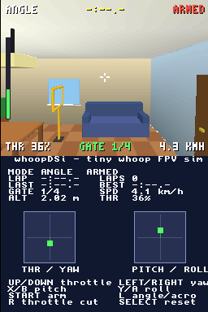

# whoopDSi

A tiny-whoop FPV drone simulator for the Nintendo DSi and DS, built as homebrew.



- **Top screen:** the FPV camera view (DS 3D engine, 15° camera uptilt) with an OSD showing mode, arm state, lap timer, throttle bar, speed and the next gate.
- **Bottom screen:** flight data (lap, last and best lap, gate, speed, altitude, throttle) and a live monitor of the two sticks.
- **Environment:** a 6 × 5 × 2.6 m living room with a table, couch, bed, bookshelf, boxes, a plant and a hanging lamp. Four race gates form a counter-clockwise loop. The next gate is green and the one after it is yellow.
- **Physics:** a 65 mm whoop with about 2.6:1 thrust-to-weight, drag, and Betaflight-style acro rates. Angle mode self-levels. Collisions bounce the quad off surfaces, and a hard hit (over 3.2 m/s) is a crash.

## Controls (Mode 2)

| Button | Stick / action |
|---|---|
| D-pad Up / Down | Throttle. It stays where you leave it, like a real throttle stick. |
| D-pad Left / Right | Yaw |
| X / B | Pitch forward / back |
| Y / A | Roll left / right |
| START | Arm or disarm. The throttle must be at 0–5% to arm. |
| L | Switch between Angle and Acro mode |
| R | Throttle cut (sets the throttle to 0) |
| SELECT | Reset to the start pad |
| Tap touch screen | Cycle speed: SLOW → MEDIUM → FAST |

The DS has no analog sticks, so every stick axis ramps smoothly. A tap gives a small correction, and holding the button builds up to full deflection over about 0.3 s. The throttle also moves faster the longer you hold Up or Down. Hover is around **36%** throttle on FAST.

### Speed profiles

The game starts on **SLOW**. Tap the bottom screen to cycle profiles. The current one is shown on the bottom screen.

| Profile | Thrust-to-weight | Rates | Max lean (Angle) | Hover throttle |
|---|---|---|---|---|
| SLOW | 1.9 | 50% | 25° | ~50% |
| MEDIUM | 2.2 | 75% | 35° | ~43% |
| FAST | 2.6 | 100% | 50° | ~36% |

SLOW and MEDIUM also add drag, so the top speed is lower.

Lap timing starts when you fly through gate 1. It stops when you fly through gate 1 again after passing gates 2–4 in order.

## Running it on a DSi

Copy `whoopDSi.nds` to the SD card, for example to `sd:/roms/nds/` or the root folder. Then launch it from **TWiLight Menu++**, **hbmenu** or any other homebrew launcher (Unlaunch or hiyaCFW setups). It also runs on a DS or DS Lite through a flashcart, and in melonDS or DeSmuME.

## Building

You need Docker. The build uses the official `devkitpro/devkitarm` image, so nothing else has to be installed.

```sh
./build.sh          # -> whoopDSi.nds
./build.sh clean
```

If devkitPro is installed locally (`DEVKITARM` set), plain `make` works too.

`icon.bmp` is the 32×32, 16-colour menu icon. It is generated by `tools/make_icon.py` (Python standard library only) and committed, so you don't need Python to build. No other assets are needed: all geometry and colours are created in code.

## Source layout

| File | Purpose |
|---|---|
| `source/main.c` | Main loop, arming, crash handling, lap and gate logic |
| `source/input.c` | Maps the buttons to stick values with ramping and expo |
| `source/quad.c` | Flight physics and the Angle/Acro controllers |
| `source/world.c` | Room, furniture and gate layout, collisions, gate crossing |
| `source/render.c` | 3D scene (baked into fixed-point quads), FPV camera, OSD pixel font |
| `source/hud.c` | Bottom-screen text console and stick monitor |

To tune the feel, edit the `speeds[]` table and `#define`s at the top of `quad.c` (rates, thrust-to-weight, drag, lean angle), `input.c` (ramp speed, expo) and `quad.h` (camera uptilt).
